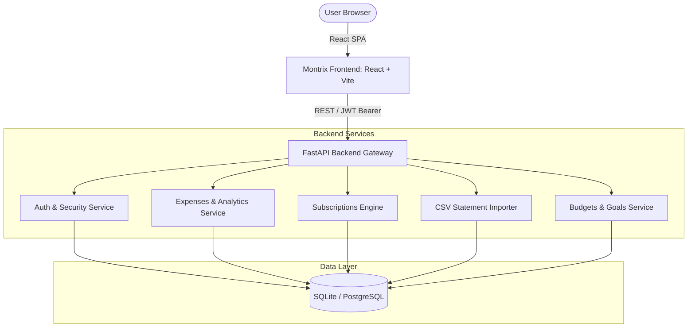

# Montrix 💸 — Personal Finance & Expense Intelligence

[](https://www.python.org/)
[](https://fastapi.tiangolo.com/)
[](https://reactjs.org/)
[](https://vitejs.dev/)
[](https://docs.pytest.org/)
[](https://opensource.org/licenses/MIT)

> **Montrix** is a full-stack personal finance and wealth management platform built with **FastAPI** and **React (Vite)**. Engineered with a dark fintech aesthetic, glassmorphic design tokens, and banking statement intelligence.

---

## 🌟 Key Features

### 1. 📊 Expense & Cash Flow Intelligence
- **Real-Time Ledger**: Log, edit, categorize, and filter expenses with sub-millisecond responsiveness.
- **Dynamic Filters**: Filter by date range presets (*This Month, Last Month, 30 Days, 90 Days*), category tags, or instant debounced search.
- **Export to CSV**: One-click streaming download of your entire financial transaction history.

### 2. 🏦 Bank Statement & CSV Importer
- **Universal CSV Parser**: Ingests statement exports from Indian and International banks (HDFC, SBI, ICICI, Chase, Revolut, etc.) with automatic UTF-8/Latin-1 decoding.
- **Intelligent Header Detection**: Automatically detects `Date`, `Description`, `Amount`, and `Category` columns.
- **Keyword Auto-Categorization**: Merchant intelligence auto-tags transactions (e.g. *Zomato/Swiggy* &rarr; Food, *Uber/Ola* &rarr; Transport, *Amazon/Flipkart* &rarr; Shopping, *BESCOM/Jio* &rarr; Bills).
- **Duplicate Prevention**: Fingerprint hashing on `(date, description, amount)` prevents double-logging past transactions.
- **Live Data Preview**: Inspect parsed records before committing to the ledger.

### 3. 🔄 Automated Recurring Subscriptions Engine
- **Lifecycle Tracking**: Manage recurring subscriptions (Weekly, Monthly, Quarterly, Yearly) with next billing renewal calculations.
- **One-Click Settlement**: Click **Log Paid** to record the expense in your ledger and automatically calculate the next renewal date.
- **Due Bills Banner**: Real-time visual alerts for overdue or upcoming bills with a single-click **Auto-Log All Due Bills** batch processor.

### 4. 📈 Analytics, Budgets & Goals
- **Interactive Visualizations**: Powered by `Recharts` — monthly spending bar charts, category distribution donuts, and cash flow trends.
- **Monthly Budget Guardrails**: Set spending limits per category with progress indicators and over-budget warnings.
- **Savings Goals**: Track milestones, target amounts, and saved balances.

### 5. 🔐 Multi-Tenant Security & Account Controls
- **JWT Authentication**: Token-based authentication with expiration protection and session refresh.
- **Bcrypt Hashing**: Passwords encrypted using industry-standard cryptographic salts.
- **User Isolation**: Strict tenant isolation across all database queries.
- **Account Control**: Live profile editing, password changing, and an authenticated cascading account wipe (*Danger Zone*).

---

## 🛠️ Tech Stack

| Domain | Technologies |
|---|---|
| **Frontend** | React 18, Vite, React Router v6, Recharts, Lucide Icons |
| **Styling** | Custom Glassmorphic CSS Design System (Zero UI framework bloat) |
| **Backend** | Python 3.11+, FastAPI, Pydantic V2, Uvicorn |
| **Database** | SQLite via SQLAlchemy Core (PostgreSQL ready) |
| **Testing** | Pytest, TestClient, In-Memory Isolated Database Engine |

---

## 🏗️ Architecture



---

## 📁 Repository Structure

```
Montrix/
├── backend/
│   ├── app/
│   │   ├── database/          # Database connection, schemas, and queries
│   │   │   ├── connection.py
│   │   │   ├── expense_db.py
│   │   │   ├── subscription_db.py
│   │   │   └── user_db.py
│   │   ├── routes/            # FastAPI API endpoints
│   │   │   ├── auth.py
│   │   │   ├── expenses.py
│   │   │   ├── subscriptions.py
│   │   │   └── ...
│   │   ├── schemas/           # Pydantic data validation models
│   │   └── services/          # Business logic (importer, auth, calculations)
│   ├── tests/                 # Automated Pytest suite (51 tests)
│   │   ├── test_auth.py
│   │   ├── test_expenses.py
│   │   └── test_subscriptions.py
│   └── requirements.txt
│
├── frontend/
│   ├── src/
│   │   ├── components/        # Reusable UI components (Modals, Cards, Charts)
│   │   │   ├── ImportExpensesModal/
│   │   │   ├── AddExpenseModal/
│   │   │   └── ...
│   │   ├── context/           # Currency & Authentication Contexts
│   │   ├── pages/             # Dashboard, Expenses, Subscriptions, Analytics, Settings
│   │   ├── services/          # Centralized API fetch services
│   │   └── index.css          # Design system & CSS variables
│   └── package.json
│
└── README.md
```

---

## 🚀 Quick Start Guide

### Prerequisites
- **Python**: 3.11 or higher
- **Node.js**: 18.0 or higher
- **Git**

### 1. Clone the Repository
```bash
git clone https://github.com/Suriya-021/Montrix.git
cd Montrix
```

### 2. Backend Setup
```bash
cd backend

# Create and activate virtual environment
python -m venv venv

# Windows:
.\venv\Scripts\activate
# macOS/Linux:
source venv/bin/activate

# Install dependencies
pip install -r requirements.txt

# Run database & start API server (http://localhost:8000)
uvicorn app.main:app --reload --port 8000
```
> Interactive Swagger API docs are available at: `http://localhost:8000/docs`

### 3. Frontend Setup
```bash
cd ../frontend

# Install dependencies
npm install

# Start development server (http://localhost:5173)
npm run dev
```

---

## 🧪 Running the Backend Test Suite

Montrix includes comprehensive automated tests covering authentication, expense math, multi-tenancy, recurring bills, and the CSV importer engine.

```bash
cd backend
.\venv\Scripts\pytest.exe -v
```

```
collected 51 items
tests/test_auth.py ......................... [ 17%]
tests/test_budgets.py .......                [ 31%]
tests/test_categories.py .......             [ 45%]
tests/test_expenses.py ...........           [ 66%]
tests/test_goals.py .....                    [ 76%]
tests/test_income.py .....                   [ 86%]
tests/test_subscriptions.py .......         [100%]

======================= 51 passed in 27s =======================
```

---

## 📄 License

This project is licensed under the [MIT License](LICENSE).
